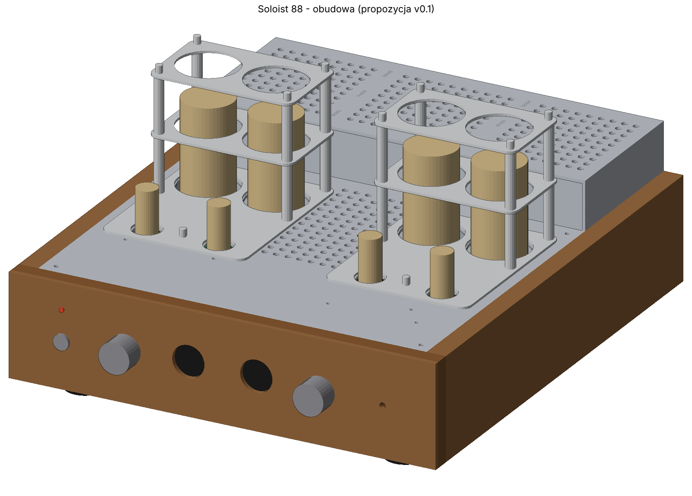

# Soloist 88 — stereofoniczny wzmacniacz lampowy na KT88

Projekt DIY wzmacniacza lampowego w stereo, opartego na układzie **Mullard 5-20** w wersji TubeMack „Soloist” przerobionej na **KT88**:

**EF86 → E88CC (odwracacz z długim ogonem, źródło prądowe DN2540) → 2× KT88 w układzie ultraliniowym, bias stały ≈ −80 V**

Do tego sterowanie na **ESP32-S3**: sekwencja włączania, pomiar prądu każdej KT88, automatyczna korekta biasu, przełącznik UL/trioda, przełącznik kolumn Marantz / Lampa i wejście trigger 12 V z amplitunera.

> ⚠️ **Wysokie napięcie.** W tym urządzeniu jest do ok. 560 V DC i 230 V AC. Kondensatory trzymają ładunek po wyłączeniu. Budujesz i uruchamiasz na własną odpowiedzialność, a pierwsze włączenia rób przez żarówkę szeregową, zgodnie z [procedurą uruchomienia](docs/06-uruchomienie.md).

## Najważniejsze parametry (z obliczeń, jeszcze nie z pomiarów)

| | |
|---|---|
| Moc | ok. 45 W na kanał na 4 Ω (zasilacz liczony na tę moc ciągłą) |
| Czułość | ok. 160 mV na pełną moc (dobierana R104) |
| Sprzężenie zwrotne | 14–16 dB |
| B+ | ok. 465 V, KT88 ok. 55 mA, ok. 25 W strat na lampę |
| Transformatory wyjściowe | Toroidy.pl TTG-KT88PP, 4 kΩ, UL |
| Transformator sieciowy | toroid 400 VA, jeden na oba kanały |

## Zawartość repozytorium

| Katalog | Co tam jest |
|---|---|
| [`docs/`](docs/) | dokumentacja: układ, zasilanie, sterowanie, płytki, obudowa, uruchomienie, zakupy, decyzje |
| [`hardware/pcb/`](hardware/pcb/) | gotowe pliki płytek: import do EasyEDA Pro, projekty KiCad, PDF-y rozmieszczenia, BOM do JLCPCB i LCSC, [`CZYTAJ_MNIE.txt`](hardware/pcb/CZYTAJ_MNIE.txt) |
| [`hardware/case/`](hardware/case/) | obudowa: STEP (do Fusion 360), DXF do cięcia laserem, lista części, widoki |
| [`site/index.html`](site/index.html) | strona projektu: schematy, punkty pracy, sekwencja, zabezpieczenia, lista elementów |
| [`src/`](src/) | skrypty w Pythonie, które generują wszystko powyżej ([jak uruchomić](src/README.md)) |

## Płytki

| Płytka | Rozmiar | Ilość | Opis |
|---|---|---|---|
| `kanal` | 100 × 100 mm | 2 | EF86, E88CC, źródło prądowe, sieć biasu i sprzężenia zwrotnego |
| `zasilacz_siec` | 100 × 100 mm | 1 | miękki start K1/K2, bezpieczniki F2/F3, prostownik biasu, żarzenie |
| `zasilacz_hv` | 100 × 100 mm | 1 | K3/K4, mostek UF5408, kondensatory C1/C2, dzielnik pomiaru B+, LED HV |
| `sterowanie` | 100 × 100 mm | 1 | ESP32-S3, 2× ADS1115, MCP4728 + LM324, ULN2803, IRM-15-12; elementy SMD montuje JLCPCB |
| `ul` | 74 × 48 mm | 2 | przekaźniki UL/trioda (G2RL-2), jeden na KT88 |
| `glosniki` | 100 × 42 mm | 1 | przełącznik kolumn Marantz / Lampa (2× G2RL-2) |

## Dokumentacja

1. [Układ i punkty pracy](docs/01-uklad.md)
2. [Zasilanie i transformatory](docs/02-zasilanie.md)
3. [Sterowanie ESP32: korekta biasu, UL/trioda, kolumny, trigger](docs/03-sterowanie.md)
4. [Płytki PCB: EasyEDA, klasy sieci, JLCPCB](docs/04-plytki-pcb.md)
5. [Obudowa](docs/05-obudowa.md)
6. [Uruchomienie krok po kroku](docs/06-uruchomienie.md)
7. [Źródła sygnału i poziomy (WiiM, Marantz, selektor)](docs/07-zrodla-i-poziomy.md)
8. [Części i zakupy: lampy, przewody, przekaźniki, BOM](docs/08-czesci-i-zakupy.md)
9. [Historia decyzji i poprawek](docs/09-historia-decyzji.md)
10. [Do zrobienia / do sprawdzenia](docs/10-do-zrobienia.md)

## Stan

- Płytki: wersja **0.23**. Kanał po routingu w EasyEDA (wersja 0.21, od tamtej pory bez zmian). Pozostałe płytki do routingu.
- Obudowa: wersja **0.4**.
- Strona projektu: wersja **0.12**.
- Program ESP32: opisany (sekwencje, algorytmy, progi), jeszcze nienapisany.
- Przed zamówieniem płytek: [lista rzeczy do sprawdzenia](docs/10-do-zrobienia.md#przed-zamówieniem-płytek).
