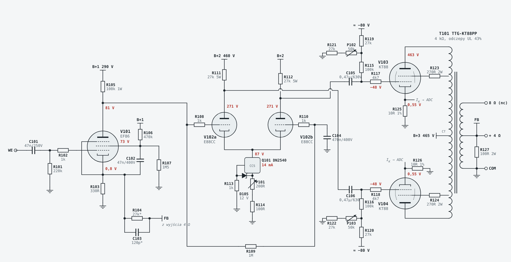

# 1. Układ i punkty pracy

## Tor sygnału

1. **Wejście:** C101 47 nF (PP) + R101 220k, czyli impedancja wejściowa 220 kΩ i filtr ok. 15 Hz, który chroni transformator przed infradźwiękami.
2. **EF86 (V101):** pentoda, wzmacniacz napięciowy. Katoda 0,8 V, anoda ok. 81 V, siatka ekranowa ok. 73 V, IK ok. 2,5 mA. Sprzężenie zwrotne (R104, C103) wchodzi na katodę EF86.
3. **E88CC (V102):** odwracacz fazy z długim ogonem, sprzężony bezpośrednio z anodą EF86. Ogon to źródło prądowe na **DN2540N5** (Q101, ok. 14 mA, 1,2 W, mały radiator). Anody ok. 271 V, rezystory anodowe R111/R112 27k 5 W, ok. 7 mA na sekcję.
4. **KT88 (V103/V104):** push-pull UL, sprzężenie przez C105/C106 0,47 µF 630 V, upływ siatek R115/R116 100k do sieci biasu. Bias stały, regulowany osobno dla każdej lampy (P102/P103).
5. **Wyjście:** Toroidy.pl TTG-KT88PP 4 kΩ z odczepami UL. Sprzężenie zwrotne brane z odczepu 4 Ω.

## Punkty pracy

| Punkt | Wartość | Uwagi |
|---|---|---|
| B+3 (środek T101/T201) | 465 V | po dławiku L1, anody KT88 ok. 463 V |
| B+2 (LTP) | 460 V | R130 330 Ω, C130 220 µF |
| B+1 (EF86) | 290 V | R131 68k |
| EF86: katoda / anoda / g2 | 0,8 / 81 / 73 V | IK ok. 2,5 mA |
| LTP: katody / anody | 87 / 271 V | 7 mA i 1,3 W na sekcję (max 1,5 W) |
| KT88: siatka | ok. −45…−55 V | zależnie od egzemplarza |
| KT88: prąd katody | 55 mA (0,55 V na 10 Ω) | ok. 25 W strat anody (35 W dopuszczalne) |
| Szyna biasu | ok. −80 V | 65 V AC, mostek, C-R-C |
| Elewacja żarzenia EF86/E88CC | +42 V | bo katody LTP są na 87 V |
| Tętnienia B+3 | ok. 30 mV p-p | filtr LC ok. 460× |

## Zgodność z kartą KT88 (Genalex / GEC)

Karta Genalex Gold Lion KT88 (dane GEC) podaje dla push-pull UL z biasem stałym: **460 V, 2 × 50 mA, 4 kΩ między anodami, bias ok. −59 V, 70 W przy 2% THD**.

- **Punkt pracy i transformator** odpowiadają danym z karty (465 V, 55 mA, 4 kΩ).
- **Ograniczenia z karty:**
  - straty anody: ok. 25 W przy dopuszczalnych 35 W (bezwzględnie 42 W) ✔
  - rezystancja w obwodzie siatki przy biasie stałym: do 220 kΩ, u nas ok. 120 kΩ ✔
  - napięcie żarzenie–katoda: do 200 V ✔
  - osobna regulacja biasu każdej lampy ✔
- **70 W z karty to nie nasze 45 W, i to celowo.** Przy pełnej mocy karta podaje ok. 140 mA na lampę, czyli w stereo ok. 0,6 A z zasilacza. Nasz dławik ma 400 mA, a uzwojenie S1 0,65 A. Zasilacz jest policzony na ok. 45 W ciągłej mocy na kanał. Przy muzyce szczyty są krótkie, więc to wystarcza. Przy pomiarach pełnej mocy sinusem rób krótkie próby.
- **Zakres biasu – propozycja zmiany.** Karta podaje ok. −59 V przy 50 mA, a obecny zakres potencjometrów z podłączoną korektą kończy się na ok. −56 V. Propozycja: **R119/R120 z 27k na 20k** (sama wartość, bez zmian w płytce). Zakres wyniesie wtedy −48…−59 V z korektą, a przerwany przewód korekty podgrzeje lampę tylko o 2,1 V zamiast 4,5 V. **Jeszcze niewprowadzone**, patrz [do zrobienia](10-do-zrobienia.md).

## Soloist 88 a Williamson

| | Williamson (1947) | Mullard 5-20 / Soloist 88 |
|---|---|---|
| Stopnie | 4: trioda, inwerter katodynowy, driver, wyjście | 3: pentoda EF86, LTP, wyjście |
| Lampy sterujące | 2–3 podwójne triody (6SN7) | EF86 + E88CC |
| Lampy mocy | pierwotnie triody (KT66 w połączeniu triodowym) | KT88 w UL |
| Sprzężenie zwrotne | 20 dB, przez 4 stopnie, wymaga bardzo dobrego transformatora | 14–16 dB, przez 3 stopnie, łatwiej o stabilność |
| Czułość | mniejsza | większa (pentoda) |

Onyx (Darek) zaproponował odsprzedaż swojej gotowej, uruchomionej płyty Williamsona (bez transformatorów i lamp). Gdy przyśle schemat, porównamy: impedancja transformatora wyjściowego, B+, rodzaj biasu, żarzenie lamp sterujących. Zasilacz, sterowanie, obudowa i transformatory z tego projektu można do niej dostosować.

## Tryb UL / trioda

Opcjonalny przełącznik (płytki `ul`, jeden przekaźnik na każdą KT88): siatka ekranowa dostaje napięcie z anody zamiast z odczepu UL. Moc spada do ok. 20–25 W, brzmienie robi się łagodniejsze. Przełączanie tylko przy wyłączonym B+. Szczegóły w [sterowaniu](03-sterowanie.md#przełącznik-ul--trioda).

## Klasa A / AB

Przy 55 mA lampy pracują w **klasie AB1**. Pierwsze ok. 5–8 W to czysta klasa A, a przy domowej głośności (średnio 1–2 W) wzmacniacz praktycznie cały czas gra w klasie A. Pełna klasa A przy 465 V nie wchodzi w grę: wymagałaby ok. 46 W strat na lampę. Tryb „gorący AB” (65 mA, ok. 30 W) jest możliwy jako ustawienie w programie korekty biasu, ale różnica w brzmieniu jest niewielka, a lampy zużywają się szybciej.
