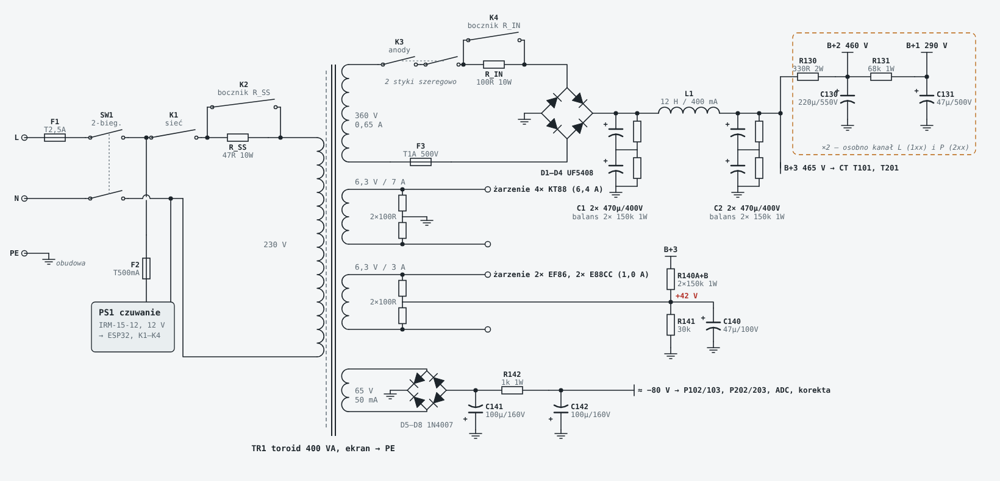

# 2. Zasilanie i transformatory

## TR1: toroid sieciowy 400 VA (Toroidy.pl)

| Uzwojenie | Napięcie | Prąd | Do czego |
|---|---|---|---|
| Pierwotne | 230 V | | z ekranem elektrostatycznym |
| S1 anodowe | 360 V AC | 0,65 A | mostek UF5408, B+ ok. 465 V; opcjonalny odczep 345 V, gdyby B+ wyszło powyżej 480 V |
| S2 żarzenie mocy | 6,3 V | **8 A** (zalecane zamiast 7 A) | 4× KT88 = 6,4 A; 4× KT120 = 7,2–7,8 A |
| S3 żarzenie sygnałowe | 6,3 V | 3 A | 2× EF86 + 2× E88CC = 1 A, podniesione do +42 V |
| S4 bias | 65 V AC | 50 mA | szyna biasu ok. −80 V |

**S2 na 8 A:** różnica w cenie jest pomijalna, a później można włożyć KT120 bez wymiany transformatora. Przy KT88 żarzenie wyjdzie ok. 6,4–6,5 V, co mieści się w tolerancji (±10%).

W obudowie toroid sieciowy i dławik leżą jeden na drugim, ze środkami zalanymi żywicą.

## Dławik L1

Toroidalny **12 H / 400 mA, DCR 66,5 Ω** (Toroidy.pl). Przy ok. 0,33 A spadek na nim to ok. 22 V. Do sprawdzenia u producenta: czy indukcyjność jest podana przy prądzie stałym.

## Przekaźniki i miękki start

| Przekaźnik | Funkcja |
|---|---|
| K1 | sieć do TR1 przez R_SS (47 Ω 10 W) |
| K2 (+1,5 s) | zwiera R_SS |
| K3 (+45 s) | 360 V AC do mostka, dwa styki szeregowo, przez R_IN |
| K4 (+1,5 s) | zwiera R_IN (100 Ω 10 W) |

Wszystkie to **Omron G2RL-2-DC12** (LCSC C61458). K1, K2 i K4 mają oba styki równolegle.

R_IN zmieniony z 47 na **100 Ω**: udar ładowania C1 przez styki K3 wynosi teraz ok. 5 A zamiast 11 A, przy przekaźniku na 8 A.

## Szyna biasu

65 V AC → mostek 1N4007 → C141 100 µF → **R142 1k** → C142 100 µF, co daje ok. **−80 V** przy obciążeniu ok. 7,3 mA (4 sieci biasu, pomiar i automatyczna korekta). Przy sieci −10% wychodzi −71 V, przy +10% −89 V.

R142 zmieniony z 1k5 na 1k, bo korekta biasu dodatkowo obciąża szynę (ok. 0,9 mA na lampę).

## Zabezpieczenia

| | Wartość | Gdzie | Uwagi |
|---|---|---|---|
| F1 | T2,5A 5×20 | gniazdo IEC | zwłoczny |
| F2 | T500mA 5×20 | zasilacz_siec | osobno dla IRM-15-12 (standby) |
| F3 | T1A, **min. 400 V AC** | zasilacz_siec, w uzwojeniu S1 | oprawka też min. 400 V; w LCSC brak, więc TME |
| LED HV | D13 + 2× 220k | zasilacz_hv | świeci, dopóki na kondensatorach jest napięcie |
| Rezystory upływowe | R3–R6 150k 1 W | zasilacz_hv | rozładowanie i wyrównanie napięć C1/C2 |
| R127 | 100 Ω 2 W | wtórne każdego TG | transformator nigdy nie pracuje bez obciążenia |

Odstęp 230 V / HV od strony 12 V na płytkach: **≥ 6 mm**. Na płytce sterowania strefa 230 V (IRM-15-12) ma ≥ 7,9 mm.

## Masa

Masa gwiazdowa w **J15 (GND_STAR) na płytce zasilacza HV**. Każda płytka ma do niej osobny przewód 1 mm². Masa sterowania łączy się z masą wzmacniacza tylko tam.

## Żarzenie

- **KT88:** S2, sztuczny środek R11/R12 do masy. Przewody 1–1,5 mm², skręcone parami, przy samym dnie.
- **EF86/E88CC:** S3, sztuczny środek R13/R14 podniesiony do +42 V (dzielnik R140A/B + R141 z B+3, C140 47 µF).
