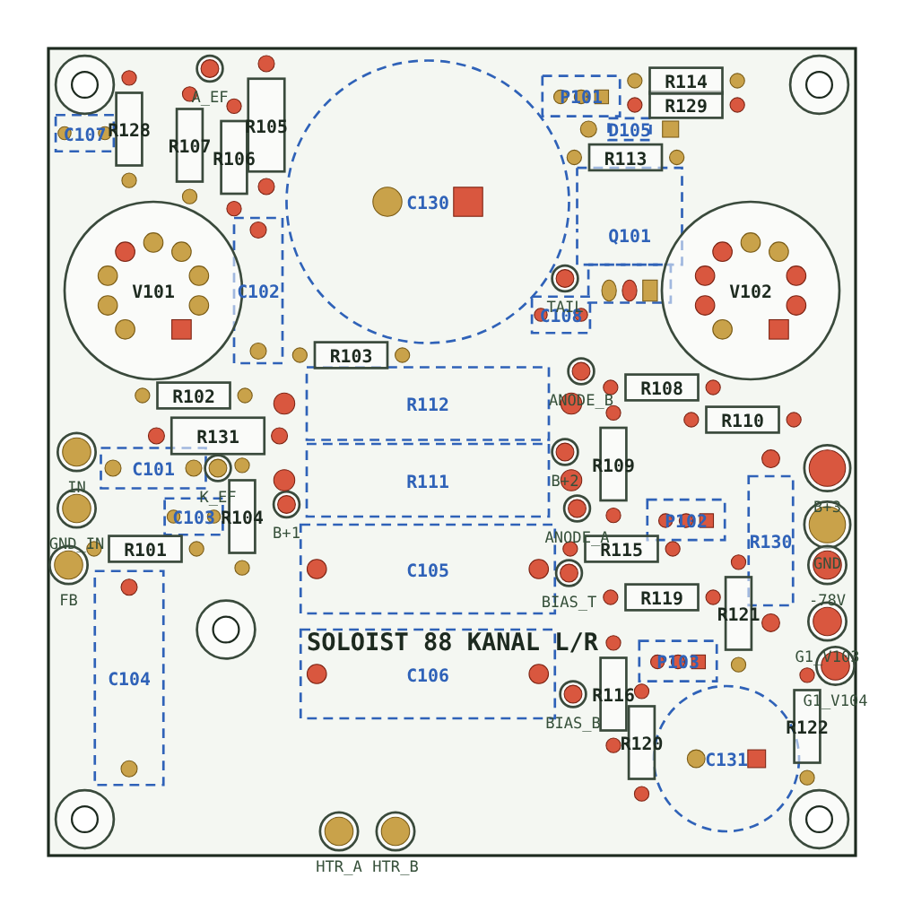

# 4. Płytki PCB

Pliki: [`hardware/pcb/`](../hardware/pcb/). Szczegółowy opis każdej płytki jest w [`CZYTAJ_MNIE.txt`](../hardware/pcb/CZYTAJ_MNIE.txt).

| Folder | Zawartość |
|---|---|
| `1_import_EasyEDA` | paczki do importu w EasyEDA Pro i Standard (KiCad 5.1) |
| `2_projekty_KiCad` | projekty KiCad (schemat + PCB) |
| `3_pakiet_awaryjny` | PDF-y rozmieszczenia 1:1, listy elementów, klasy sieci (CSV) |
| `4_montaz_SMD_JLCPCB` | BOM do montażu SMD płytki sterowania w JLCPCB |
| `5_BOM_czesci_LCSC` | BOM-y do zamówienia części, osobno dla każdej płytki |

## Import do EasyEDA Pro

- Import „KiCad” z paczki `*_EasyEDA_Pro.zip`. Schemat i PCB mają wspólne identyfikatory, więc „Update PCB from schematic” działa.
- **Klasy sieci** (szerokości i odstępy) przechodzą przy imporcie. Kopia jest w `*_klasy_sieci.csv`.
- Komunikat DRC „netlist does not match” po imporcie zwykle oznacza tylko różnicę w identyfikatorach, a nie błąd połączeń. Przy każdej wersji CZYTAJ_MNIE mówi, które płytki się zmieniły.
- Rozmieszczenie elementów w paczkach jest przemyślane (np. lampy na brzegach płytki kanału, kondensatory płytki kanału na spodzie), więc nie warto go oddawać automatowi.

## Klasy sieci (skrót)

| Płytka | Klasa | Ścieżka | Odstęp | Sieci |
|---|---|---|---|---|
| kanal | HV | 0,6 | 2,5 | B+3, B+2 |
| kanal | ANODA | 0,5 | 1,25 | B+1, anody (mieści się między nóżkami podstawki noval; IPC-2221 do 300 V) |
| kanal | BIAS | 0,4 | 1,0 (3,0 do HV) | VBIAS, siatki KT88 |
| kanal | ZARZENIE | 1,0 | 0,5 | HTR_A/B, parami |
| zasilacz_siec | SIEC_230 | 2,0 | 3,0 (6,0 do cewek) | sieć |
| zasilacz_hv | HT_AC / HV_DC | 1,5 | 3,0 (6,0 do cewek) | 360 V AC, 465–510 V DC |
| sterowanie | SIEC_230 | 0,8 | 3,0 (6,0 do reszty) | tylko J1 → PS1 |
| sterowanie | BIAS_KOR | 0,3 | 1,5 | wyjścia korekty biasu (ok. −50 V) |
| ul | UL_HV | 0,8 | 2,5 (6,0 do cewek) | anody, odczepy UL, G2 |
| glosniki | GLOSNIK | 2,0 | 0,5 | do ok. 5 A |

Pełna tabela jest w `CZYTAJ_MNIE.txt`.

## Zamawianie w JLCPCB

- Płytki 10 × 10 cm, FR-4 1,6 mm, miedź 1 oz (z promocji) wystarczą. Szerokości ścieżek są dobrane pod 1 oz z zapasem.
- **Montaż SMD (tylko płytka sterowania):** `sterowanie_BOM_JLCPCB.csv` + plik CPL wygenerowany w EasyEDA **po** routingu. W podglądzie sprawdź orientację układów scalonych i diod.
  - Części „Extended” (opłata za typ): ADS1115IDGSR, MCP4728-E/UN, LM324DR i ULN2803G-S18-R (do sprawdzenia).
  - Rezystory i kondensatory 0805 oraz 1N4148W: „Basic”.
- Elementy przewlekane lutujesz sam.

## Sprawdzenia wykonane przy każdej wersji

- zgodność schematu z płytką (wszystkie płytki);
- kolizje elementów: 0;
- odstępy wysokiego napięcia (`hvcheck.py`): 0 naruszeń;
- przegląd całości po dodaniu korekty biasu: znalezione i poprawione 3 błędy, patrz [historia](09-historia-decyzji.md).

## Przed zamówieniem płytek

Patrz [do zrobienia](10-do-zrobienia.md#przed-zamówieniem-płytek): wyprowadzenia G2RL-2, footprint i kolejność pinów IRM-15-12, rozstaw listew ESP32, obudowa ULN2803G-S18-R, wydruk 1:1.
