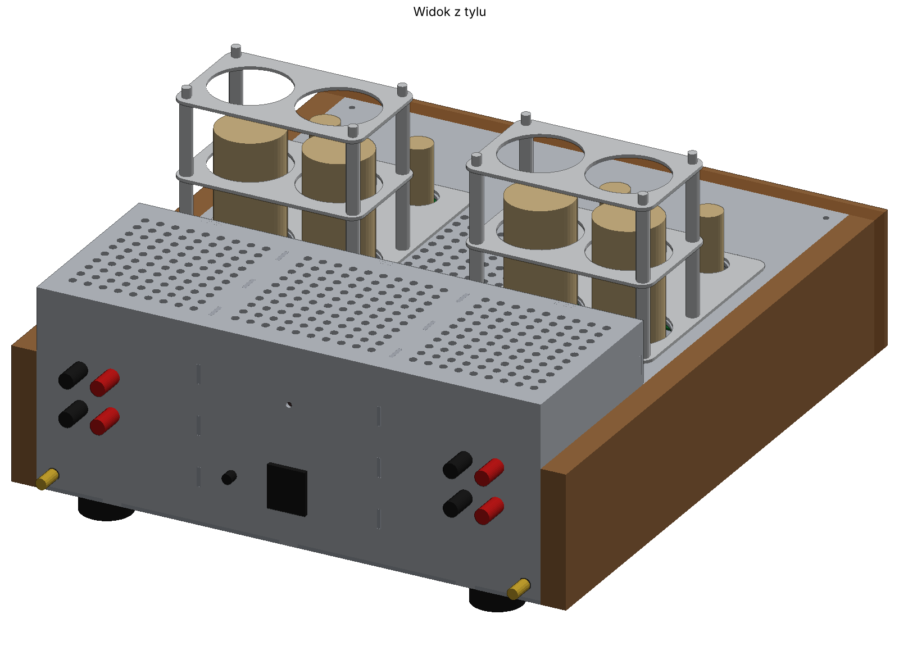
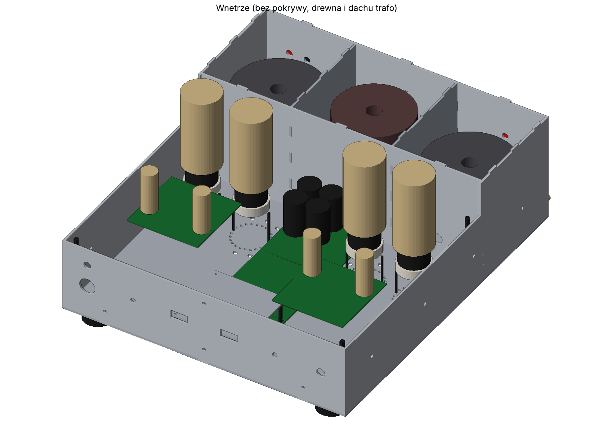

# 5. Obudowa

Pliki: [`hardware/case/`](../hardware/case/), szczegóły w [`CZYTAJ_MNIE_obudowa.txt`](../hardware/case/CZYTAJ_MNIE_obudowa.txt).

## Założenia

- **Aluminium 3 mm** (stop 5754 lub 5052, dobrze się gnie i spawa; 6061/6082 pęka przy gięciu).
- **Osobna obudowa transformatorów z tyłu** (wszystkie transformatory pod jedną osłoną), z opcjonalnymi przegrodami.
- **Boki i front z drewna:** MDF + fornir, front 5 + 15 mm z kieszeniami na gałki i wyświetlacze.
- **Osłona lamp ze stali nierdzewnej:** ramki 2,5 mm na prętach M4 z tulejkami. W wersji 0.4 podniesiona o 15 mm (górna ramka Z 225), żeby zmieściły się też KT120.
- **Połączenia na wypusty** 15 × 3 mm z gniazdami (luz 0,1 mm), do spawania i szlifowania.
- **Pokrywa części lampowej** zdejmowana, 4 wkręty M4 w tuleje 100 mm. Zdjęcie jej nie rusza transformatorów.
- **Podstawki KT88** na szpilkach w dnie. 24 otwory co 15° pozwalają obrócić podstawkę.

## Wymiary

Dno 400 × 460 mm. Z drewnianymi bokami 440 mm szerokości, z frontem 480 mm głębokości. Część lampowa ma 100 mm wnętrza, obudowa transformatorów do Z 156.

## Ekranowanie i prowadzenie wejść

- **Aluminium nie ekranuje pola magnetycznego 50 Hz, stal tak.** Przewody wejściowe biegną w **stalowych profilach 20 × 20 × 1,5** pod transformatorami głośnikowymi, które są podniesione o 35 mm na tulejach.
- **Wejścia RCA są z tyłu** (DAC zewnętrzny). Gniazda izolowane od obudowy, ekran kabla połączony z masą tylko po stronie płytki.
- **Nad płytką sterowania jest ekran aluminiowy** (Z 47). Ogranicza zakłócenia z ESP32 i przetwornic, ale osłabia Wi-Fi, więc do zdalnego sterowania raczej IR.
- **Płytki kanałów nie przeszkadzają sterownikowi**, jeśli zachowasz rozdział: sygnał przy brzegach, sterowanie w środkowej kolumnie pod ekranem.

## Tylna ścianka (v0.4)

- gniazdo IEC C14 z bezpiecznikiem;
- śruba PE;
- 2 gniazda RCA w dolnych rogach, w osi profili;
- **4 pary zacisków głośnikowych:** górny rząd z Marantza, dolny do kolumn;
- **gniazdo TRIGGER** jack 3,5 mm (otwór 6 mm), izolowane.

## STEP do Fusion 360

Bryły są dokładne (ADVANCED_BREP): płaskie ściany, prawdziwe otwory walcowe i łuki. W Fusion importują się jako zwykłe bryły, które można wymiarować i obrabiać. DXF ma okręgi jako CIRCLE i zaokrąglenia jako łuki.

- `Soloist88_obudowa.step`: tylko części do wykonania.
- `Soloist88_obudowa_z_elementami.step`: plus elementy odniesienia (lampy, płytki, transformatory, gałki).

## Do ustalenia

Wymiary transformatorów i dławika (Toroidy.pl), podstawek KT88, gniazda IEC, zacisków, wyświetlaczy, przycisku. Modele zakładają m.in. TG ⌀120 × 65, TR1 ⌀130 × 65, dławik ⌀105 × 55.
